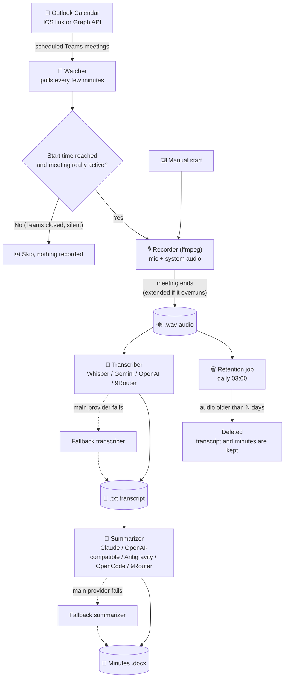

# MeetResult

**Automatically records, transcribes, and writes minutes for Microsoft Teams meetings**, integrated with **Outlook Calendar**. Full **Bahasa Indonesia** support — transcripts and minutes are produced in Indonesian.

You attend meetings as usual; MeetResult records, transcribes, and drafts clean minutes as a Word (`.docx`) document that follows your company template, so nobody has to retype notes afterwards.

> ⚠️ **Record only with consent.** MeetResult captures audio *silently* — Teams does **not** show a recording banner to other participants. Read [Privacy & Consent](#-privacy--consent) before using it.

## Contents

[Features](#-features) · [How it works](#-how-it-works) · [Privacy & Consent](#-privacy--consent) · [Install](#-install-one-click) · [Configuration](#-installation--configuration) · [Updating](#-updating)

## ✨ Features

| Area | Feature | Details |
|---|---|---|
| **Capture** | Outlook Calendar integration | ICS link or Microsoft Graph; detects scheduled Teams meetings automatically |
| | Auto-record | Starts and stops on schedule; checks the meeting is really active so conversations outside a meeting are not recorded |
| | Overrun & back-to-back handling | A meeting that runs long is not cut while Teams is running; when the next meeting starts the recording is split cleanly |
| | Manual recording | Any time, outside the calendar |
| | Stays awake | Keeps the Mac from sleeping while recording |
| **Transcription** | Providers | Whisper (local/offline), Gemini, OpenAI, any OpenAI-compatible server, or 9Router |
| | Fallback provider | Switches automatically if the main provider fails or is rate-limited |
| **Minutes** | Providers | Claude, OpenAI-compatible (cloud or local), Antigravity/Gemini, OpenCode, or 9Router, with a fallback provider |
| | Word output | `.docx` following your company template; two ready-made schemes (progress meeting or formal minutes) with real Word numbered lists |
| **App** | Menu-bar app (macOS) | Control and settings without a terminal; one-click test of every configured model |
| | Warnings & retry | Alerts with the actual error text; a *Failed* menu to retry a meeting; transient failures retried automatically |
| **Data** | Local storage | Audio, transcripts, and minutes stay on your machine (cloud providers receive only what you send them — see Privacy) |
| | Retention | Audio auto-deleted after N days; files organized per month |
| **Install** | One-click installer | Self-contained `.pkg`, no Node.js or terminal needed |

## 🧩 How it works



Failures never silently drop a meeting: they raise a warning in the menu bar, and any meeting that still has its audio or transcript can be retried from the **Gagal Diproses** (*Failed to process*) menu.

## 🔒 Privacy & Consent

Recording a conversation is a serious matter. **Recording a meeting without the knowledge and consent of the people in it is prohibited** — by most companies' policies, and in many places by law (privacy, interception, and personal-data-protection laws). This is general guidance, not legal advice; you are responsible for knowing the rules that apply to you.

**MeetResult does not announce itself.** It records through your own microphone and audio device, so Teams shows **no recording notice** to other participants. That makes it your job — not the software's — to make sure everyone knows.

Before you use it:

- ✅ **Tell every participant** that the meeting is being recorded and transcribed, and why — at the start of the meeting or in the invitation. Get an explicit yes; if anyone objects, stop recording.
- ✅ **Follow your organization's policy.** Check whether recording is allowed at all, and which meetings (HR, legal, disciplinary, customer, board, or confidential topics are often off-limits).
- ✅ **Respect other jurisdictions.** If participants are in different countries or companies, the strictest rule applies; some places require *every* party's consent.
- ✅ **Treat the output as confidential.** Audio, transcripts, and minutes can contain personal and commercial secrets. Store them securely, share only with people who were meant to receive them, and delete them when no longer needed (audio is auto-deleted after `AUDIO_RETENTION_DAYS`, 3 days by default).
- ✅ **Know where your data goes.** Local Whisper keeps audio on your machine. Cloud providers (Gemini, OpenAI, Claude, 9Router, …) receive the audio or transcript you send them and are bound by their own terms — pick a provider that your organization approves.
- 🚫 **Never use MeetResult to record covertly**, to record private conversations that are not meetings, or to record people who have not agreed.

Auto-record only watches meetings on *your* calendar, and the active-meeting checks help avoid capturing conversations outside a meeting — but these are safeguards against accidents, not a substitute for consent. Pause or stop recording whenever a conversation turns private.

## 📦 Install (one click)

Download **`MeetResult-<version>.pkg`** from the [latest release](https://github.com/aansun/MeetResult/releases/latest) and double-click it. The installer puts a self-contained **MeetResult.app** in `/Applications` (it bundles its own Node.js runtime — nothing else to install first). Open it from Launchpad: a menu-bar icon appears, the Settings window opens on first launch, and the app offers to install the two system components it cannot bundle (**ffmpeg** and the **BlackHole** audio driver) through Homebrew.

| | |
|---|---|
| **Requires** | Apple Silicon and macOS 13 or later |
| **First open** | The installer is signed ad hoc (not with an Apple Developer ID), so macOS asks for a one-time approval: right-click the `.pkg` → **Open**, and the same for the app on first launch (or **System Settings → Privacy & Security → Open Anyway**) |
| **Your data** | `~/Library/Application Support/MeetResult` (outside iCloud-synced folders) |
| **Uninstall** | Delete `/Applications/MeetResult.app`, and that data folder if you also want to remove your data |
| **Build from source** | See **[SETUP.md](SETUP.md)**; `./scripts/build-installer.sh` rebuilds the installer |

## 📚 Installation & Configuration

Prerequisites, installation, AI provider setup, calendar setup, MoM templates, and the full command reference are in **[SETUP.md](SETUP.md)**.

## 🔄 Updating

- **Installed app:** menu bar → **Cek Update...** (*Check for Updates*) opens the download page when a newer installer exists; run the new `.pkg` — your data and settings are kept.
- **Source checkout:**

```bash
meetresult update --apply
```

Repo: **https://github.com/aansun/MeetResult**
